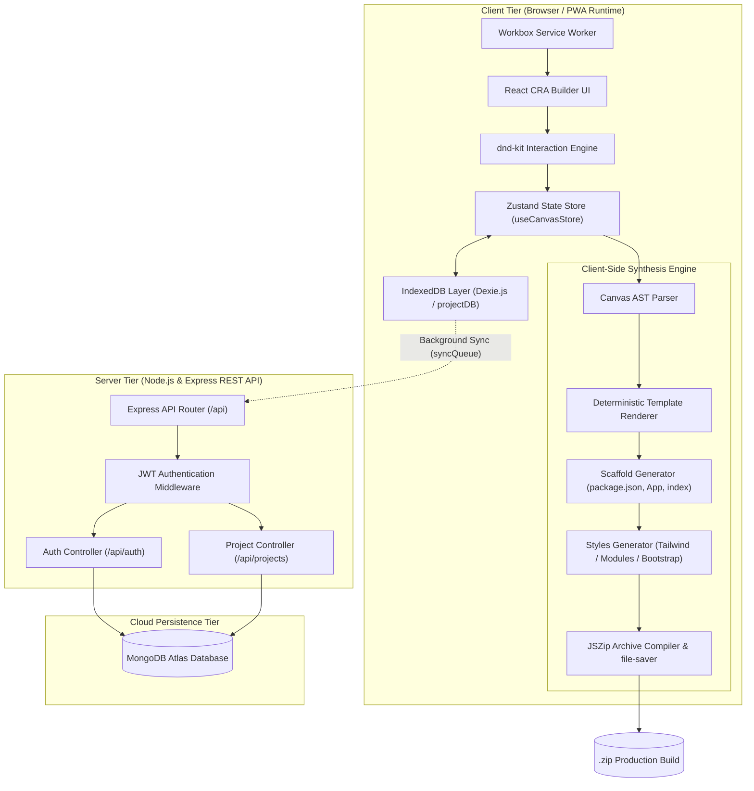
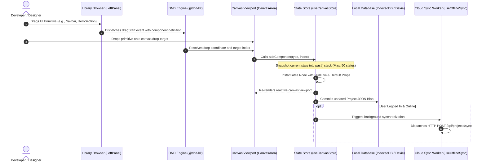
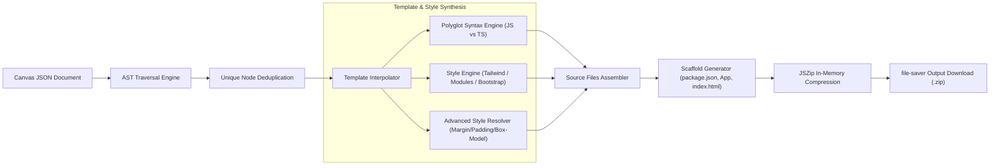
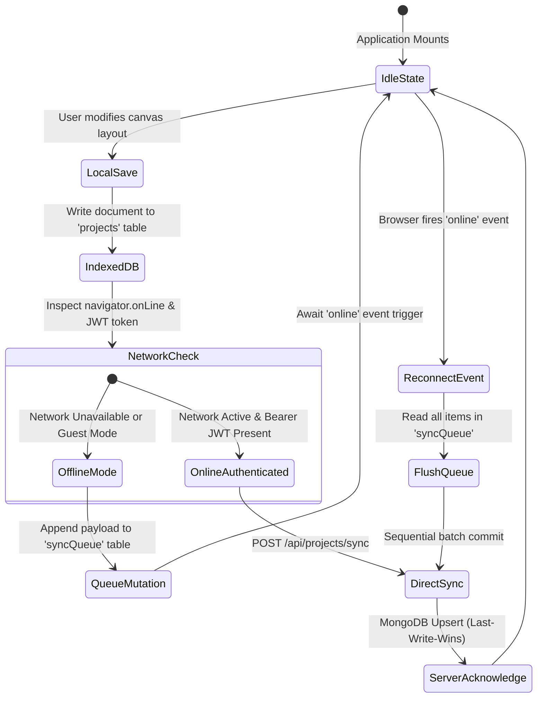
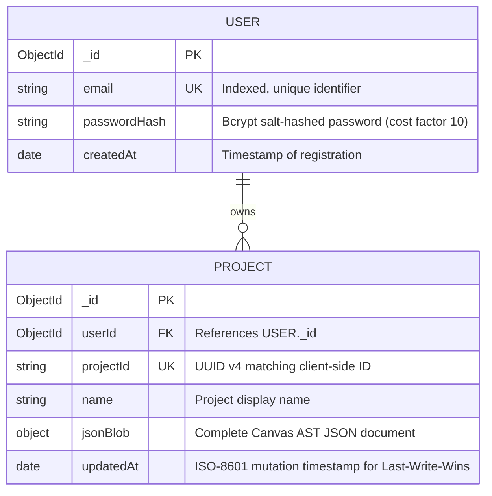

# CoDraw: A Deterministic, Offline-First Visual Website Authoring and Code Synthesis System

> **Academic Capstone Project & Technical Specification Documentation**  
> **Course / Degree:** Bachelor of Technology in Computer Science & Engineering  
> **Repository:** `codraw-monorepo` | **Engine Target:** React.js (Create React App Architecture)  
> **Runtime Environment:** Bun v1.3+ & Node.js v18+ | **Database:** MongoDB & Dexie.js (IndexedDB)

---

## 1. Abstract & Executive Summary

Modern web development demands rapid prototyping without sacrificing code quality, architectural consistency, or operational independence. Existing website builders typically introduce significant operational lock-in: they compile designs into proprietary database blobs, rely heavily on closed-source runtime widgets, or require heavy cloud microservices for server-side code generation.

**CoDraw** is a browser-based, visual website authoring system and client-side code synthesis engine designed to solve this paradigm mismatch. Built on an offline-first progressive web application (PWA) architecture, CoDraw enables developers and designers to visually compose full-page layouts via an infinite-panning, 1440px smart-grid canvas. 

Unlike conventional visual builders that rely on non-deterministic AI generation or cloud-side compiler services, CoDraw implements a **deterministic Abstract Syntax Tree (AST) code generation engine** operating entirely in the browser runtime. CoDraw parses the visual document model into an production-grade React application supporting both **JavaScript** and **TypeScript**, with native multi-framework styling support for **Tailwind CSS**, **CSS Modules**, and **Bootstrap 5**. The resulting package is bundled client-side into an unencumbered ZIP archive that can be immediately built and deployed via `npm install && npm start`.

---

## 2. System Architecture & Component Topology

CoDraw employs a **monorepo client-server architecture** structured around an offline-first execution model. The frontend acts as a fully self-sufficient authoring and compilation environment, while the backend serves as a persistence and synchronization relay for multi-device authenticated sessions.

### 2.1 High-Level Architecture



### 2.2 Subsystem Specifications

| Subsystem | Directory / Module | Academic Responsibility & Design Role |
| :--- | :--- | :--- |
| **Canvas State Engine** | [`client/src/store/useCanvasStore.js`](file:///home/vandan/Vardhaman/Main/college/codraw/client/src/store/useCanvasStore.js) | Centralized, reactive state store with 50-step linear Undo/Redo history stacks, split-view component isolation, viewport transforms, and metadata management. |
| **Interaction Engine** | [`client/src/components/CanvasArea.jsx`](file:///home/vandan/Vardhaman/Main/college/codraw/client/src/components/CanvasArea.jsx) | Handles drag-and-drop orchestration using `@dnd-kit`, spatial snapping to an 8px grid, hover-reordering controls, dynamic zoom scaling, and direct node selection. |
| **Component Registry** | [`client/src/library/index.js`](file:///home/vandan/Vardhaman/Main/college/codraw/client/src/library/index.js) | Declarative library of 23 hand-authored UI primitives. Each component encapsulates polymorphic prop schemas, multi-CSS class maps, and polyglot templates. |
| **Synthesis Compiler** | [`client/src/engine/index.js`](file:///home/vandan/Vardhaman/Main/college/codraw/client/src/engine/index.js) | Client-side static code generation pipeline. Traverses the visual tree, binds component templates, builds routing/scaffolding, and produces an archival `.zip` file. |
| **Local Persistence Layer** | [`client/src/db/projectDB.js`](file:///home/vandan/Vardhaman/Main/college/codraw/client/src/db/projectDB.js) | Browser storage layer built atop Dexie.js (IndexedDB). Guarantees complete offline functionality and maintains an asynchronous queue (`syncQueue`) for upstream updates. |
| **Synchronization Relay** | [`server/index.js`](file:///home/vandan/Vardhaman/Main/college/codraw/server/index.js) | Express.js REST gateway implementing stateless JWT authentication, idempotent cloud project upserts, and MongoDB Atlas replication. |

---

## 3. Workflow Paths & Interaction Lifecycles

### 3.1 Visual Composition & State Mutation Lifecycle

The following sequence details how user interactions travel from drag-and-drop primitives to the reactive store and immediate local persistence:



### 3.2 Client-Side Code Generation Pipeline

CoDraw's compiler runs synchronously inside the browser's JavaScript V8/WebAssembly thread without making network calls.



1. **AST Traversal:** The document's `canvas.components` array is extracted. Components with child hierarchies and navigational links (`linkTo`) are resolved.
2. **Template Synthesis:** For each unique component type used, the compiler selects the corresponding template matching `meta.language` (`js` or `ts`).
3. **Placeholder Resolution:** The engine replaces placeholder tags:
   - `{{CSS_IMPORT}}`: Replaced with scoped `.module.css` imports, CSS links, or omitted for Tailwind CSS.
   - `{{WRAPPER_CLASS}}`, `{{BRAND_CLASS}}`: Replaced with targeted CSS utility or module class tokens.
   - Props values (strings, arrays, booleans) are bound directly to JSX element attributes.
4. **Scaffolding Integration:** Standard CRA directory layouts (`src/`, `public/`, `package.json`, `README.md`) are populated with required build scripts and production dependencies.
5. **Archive Packaging:** JSZip serializes the file tree into a binary Blob, invoking `saveAs()` to trigger an immediate browser download.

### 3.3 Offline-First Dual Persistence & Conflict Resolution



---

## 4. Formal Data Schemas & Intermediate Representations

### 4.1 Canvas Abstract Syntax Tree (Document Schema)

The visual project is formally structured as a JSON document acting as the **single source of truth** across the canvas renderer, local database, and export engine.

```json
{
  "$schema": "http://json-schema.org/draft-07/schema#",
  "title": "CoDrawProjectDocument",
  "type": "object",
  "required": ["meta", "canvas"],
  "properties": {
    "meta": {
      "type": "object",
      "required": ["projectId", "name", "version", "framework", "language", "stylingSystem", "createdAt", "updatedAt"],
      "properties": {
        "projectId": { "type": "string", "format": "uuid" },
        "name": { "type": "string" },
        "version": { "type": "string", "enum": ["1.0"] },
        "framework": { "type": "string", "enum": ["react-cra"] },
        "language": { "type": "string", "enum": ["js", "ts"] },
        "stylingSystem": { "type": "string", "enum": ["tailwind", "css-modules", "bootstrap"] },
        "createdAt": { "type": "string", "format": "date-time" },
        "updatedAt": { "type": "string", "format": "date-time" }
      }
    },
    "canvas": {
      "type": "object",
      "required": ["width", "gridSize", "components"],
      "properties": {
        "width": { "type": "integer", "default": 1440 },
        "gridSize": { "type": "integer", "default": 8 },
        "components": {
          "type": "array",
          "items": {
            "type": "object",
            "required": ["id", "type", "parentId", "order", "props"],
            "properties": {
              "id": { "type": "string" },
              "type": { "type": "string" },
              "parentId": { "type": ["string", "null"] },
              "order": { "type": "integer" },
              "props": { "type": "object" },
              "advancedStyles": {
                "type": "object",
                "properties": {
                  "width": { "type": "string" },
                  "height": { "type": "string" },
                  "margin": { "type": "string" },
                  "padding": { "type": "string" },
                  "borderRadius": { "type": "string" },
                  "position": { "type": "string", "enum": ["static", "relative", "absolute", "fixed", "sticky"] },
                  "top": { "type": "string" },
                  "bottom": { "type": "string" },
                  "left": { "type": "string" },
                  "right": { "type": "string" },
                  "zIndex": { "type": "string" }
                }
              },
              "children": { "type": "array" }
            }
          }
        }
      }
    }
  }
}
```

### 4.2 Database Entity Relationship & Schema Models



#### MongoDB Mongoose Declarations
- [`server/models/User.js`](file:///home/vandan/Vardhaman/Main/college/codraw/server/models/User.js):
  ```javascript
  const userSchema = new mongoose.Schema({
    email: { type: String, required: true, unique: true },
    passwordHash: { type: String, required: true },
    createdAt: { type: Date, default: Date.now }
  });
  ```
- [`server/models/Project.js`](file:///home/vandan/Vardhaman/Main/college/codraw/server/models/Project.js):
  ```javascript
  const projectSchema = new mongoose.Schema({
    userId: { type: mongoose.Schema.Types.ObjectId, ref: 'User', required: true },
    projectId: { type: String, required: true, unique: true },
    name: { type: String, required: true },
    jsonBlob: { type: Object, required: true },
    updatedAt: { type: Date, default: Date.now }
  });
  ```

### 4.3 Browser IndexedDB Schema (Dexie.js)

The client implements database versioning in [`client/src/db/projectDB.js`](file:///home/vandan/Vardhaman/Main/college/codraw/client/src/db/projectDB.js):
```javascript
export const db = new Dexie('CoDrawDB');
db.version(2).stores({
  projects: 'meta.projectId, meta.name, meta.updatedAt',
  syncQueue: '++id, projectId, timestamp',
});
```

---

## 5. RESTful API Specification

The CoDraw backend API serves requests over HTTP/1.1 with JSON payloads. All protected endpoints validate a cryptographically signed JSON Web Token passed via standard Bearer headers.

### 5.1 Endpoint Directory

| Method | Resource Route | Protection | Description | Success Response | Error Codes |
| :--- | :--- | :--- | :--- | :--- | :--- |
| `GET` | `/api/health` | Public | System health check and database connectivity diagnostic. | `200 OK` (JSON) | `503 Service Unavailable` |
| `POST` | `/api/auth/register` | Public | Registers a new user account with hashed password credentials. | `201 Created` (Token + User) | `400 Bad Request`, `409 Conflict` |
| `POST` | `/api/auth/login` | Public | Authenticates credentials and returns a signed 7-day JWT. | `200 OK` (Token + User) | `400 Bad Request`, `401 Unauthorized` |
| `GET` | `/api/auth/me` | Bearer JWT | Verifies authorization context and returns current user details. | `200 OK` (User Profile) | `401 Unauthorized`, `404 Not Found` |
| `GET` | `/api/projects` | Bearer JWT | Retrieves all cloud projects owned by the authenticated user. | `200 OK` (Project List) | `401 Unauthorized`, `500 Internal Error` |
| `POST` | `/api/projects/sync` | Bearer JWT | Idempotently creates or updates a project document (Upsert). | `200 OK` (Upserted Record) | `400 Bad Request`, `401 Unauthorized` |
| `DELETE` | `/api/projects/:projectId` | Bearer JWT | Permanently removes a project owned by the user. | `200 OK` (Confirmation) | `401 Unauthorized`, `404 Not Found` |

### 5.2 Detailed Endpoint Contracts

#### `POST /api/auth/register`
- **Request Body:**
  ```json
  {
    "email": "developer@example.com",
    "password": "SecurePassword123!"
  }
  ```
- **Response `201 Created`:**
  ```json
  {
    "token": "eyJhbGciOiJIUzI1NiIsInR5cCI6IkpXVCJ9...",
    "user": {
      "id": "64c39b1a2f4d1e0012ab34cd",
      "email": "developer@example.com",
      "createdAt": "2026-10-10T12:00:00.000Z"
    }
  }
  ```

#### `POST /api/projects/sync`
- **Headers:** `Authorization: Bearer <JWT>`
- **Request Body:**
  ```json
  {
    "projectId": "9f32b10a-3d44-48f8-b3ee-a393d258b3e8",
    "name": "SaaS Landing Page",
    "jsonBlob": {
      "meta": { "projectId": "9f32b10a-3d44-48f8-b3ee-a393d258b3e8", "language": "ts", "stylingSystem": "tailwind" },
      "canvas": { "components": [] }
    },
    "updatedAt": "2026-10-10T12:05:30.000Z"
  }
  ```
- **Response `200 OK`:**
  ```json
  {
    "success": true,
    "project": {
      "_id": "64c39b882f4d1e0012ab34e1",
      "userId": "64c39b1a2f4d1e0012ab34cd",
      "projectId": "9f32b10a-3d44-48f8-b3ee-a393d258b3e8",
      "name": "SaaS Landing Page",
      "updatedAt": "2026-10-10T12:05:30.000Z"
    }
  }
  ```

---

## 6. Component Library & Deterministic Code Synthesis

### 6.1 Component Architecture Specification

Every visual block registered in [`client/src/library/index.js`](file:///home/vandan/Vardhaman/Main/college/codraw/client/src/library/index.js) conforms to a strict structural declaration rather than a raw JSX element. This decoupling isolates visual canvas rendering from static code synthesis:

```javascript
export const ComponentDef = {
  type: string,                // Unique identifying token (e.g. 'HeroSection')
  category: string,            // Categorical group ('Layout', 'Forms', etc.)
  label: string,               // Display label for library palettes
  icon: string,                // Visual icon identifier
  defaultProps: object,        // Baseline attributes instantiated on canvas drop
  propsSchema: Array<{        // Form schema powering the Right Properties Panel
    key: string,
    label: string,
    type: 'text' | 'color' | 'select' | 'array-text' | 'boolean'
  }>,
  styleMap: {                  // Deterministic CSS class mapping across frameworks
    tailwind: object,
    'css-modules': object,
    bootstrap: object
  },
  templates: {                 // Polyglot code synthesis templates
    js: string,                // JavaScript ES6+ JSX function component
    ts: string                 // TypeScript TSX component with interface contracts
  }
};
```

### 6.2 Component Directory (23 Standard Primitives)

```
client/src/library/
├── Layout/       ├── Navigation/   ├── Typography/   ├── Forms/             ├── Media/          ├── Composite Blocks/
│   ├── Section   │   ├── Navbar    │   ├── Heading   │   ├── Button         │   ├── Image       │   ├── Card
│   ├── Container │   └── Footer    │   ├── Paragraph │   ├── TextInput      │   └── Icon        │   ├── HeroSection
│   ├── Divider   │                 │   └── Badge     │   ├── Textarea       │                   │   ├── CTABlock
│   └── Spacer    │                 │                 │   ├── NumberInput    │                   │   └── FeatureBlock
│                 │                 │                 │   ├── SelectDropdown │                   │
│                 │                 │                 │   ├── SearchBox      │                   │
│                 │                 │                 │   ├── Checkbox       │                   │
│                 │                 │                 │   └── Radio          │                   │
```

---

## 7. Technology Stack & Academic Justification

| Architectural Layer | Technology Selected | Justification & Comparative Trade-off Analysis |
| :--- | :--- | :--- |
| **Client UI Framework** | **React.js 18 (CRA Structure)** | Chosen for industry-standard deterministic tree diffing, modular component state encapsulation, and compatibility with target generated CRA codebases. |
| **State Management** | **Zustand** | Chosen over Redux Toolkit. Minimizes boilerplate while providing unopinionated store subscribability, transient updates, and native support for undo/redo history stacks (`past`/`future`). |
| **Drag & Drop Engine** | **@dnd-kit** | Modular, accessible drag-and-drop primitives built for React. Provides coordinate detection, sensor extensibility, and collision detection algorithms without polluting DOM nodes. |
| **Client Persistence** | **Dexie.js (IndexedDB)** | Traditional `localStorage` has a ~5MB limit and synchronous execution that blocks the UI thread. Dexie provides asynchronous transactional storage capable of persisting full project trees and multi-megabyte offline queues. |
| **Export Engine** | **JSZip & file-saver** | Code synthesis occurs 100% on the client. Eliminates server-side rendering vulnerabilities, lowers infrastructure cloud costs to zero for guest users, and prevents data harvesting. |
| **Backend Runtime** | **Bun / Node.js & Express** | Lightweight, stateless REST gateway providing high I/O throughput for JSON document transfers and rapid token verification. |
| **Database** | **MongoDB Atlas & Mongoose** | Flexible document-oriented storage. Accommodates hierarchical, polymorphic JSON blobs generated by the canvas without requiring complex relational joins. |

---

## 8. Experimental Verification & Test Matrix

The code synthesis engine was validated across all 6 language-styling combinations. Each generated archive was extracted onto a clean test machine and subjected to build and execution testing:

| Configuration ID | Language Target | Styling Framework | Exported Scaffold | `npm install` Verification | `npm start` Verification | Validation Notes |
| :---: | :---: | :---: | :---: | :---: | :---: | :--- |
| **EXP-01** | JavaScript | Tailwind CSS | React CRA `.jsx` | **PASSED** (0 errors) | **PASSED** (Port 3000) | Generates `tailwind.config.js` and PostCSS setup. |
| **EXP-02** | TypeScript | Tailwind CSS | React CRA `.tsx` | **PASSED** (0 errors) | **PASSED** (Port 3000) | Compiles strictly with `tsconfig.json` prop typing. |
| **EXP-03** | JavaScript | CSS Modules | React CRA `.jsx` | **PASSED** (0 errors) | **PASSED** (Port 3000) | Scoped `[Component].module.css` files generated. |
| **EXP-04** | TypeScript | CSS Modules | React CRA `.tsx` | **PASSED** (0 errors) | **PASSED** (Port 3000) | Strict CSS module interface resolution. |
| **EXP-05** | JavaScript | Bootstrap 5 | React CRA `.jsx` | **PASSED** (0 errors) | **PASSED** (Port 3000) | Includes Bootstrap 5 bundle in `package.json`. |
| **EXP-06** | TypeScript | Bootstrap 5 | React CRA `.tsx` | **PASSED** (0 errors) | **PASSED** (Port 3000) | Full TypeScript compilation with Bootstrap classes. |

---

## 9. Installation, Local Setup, & Execution

### 9.1 System Prerequisites
- **Runtime:** [Bun](https://bun.sh/) (v1.3+ recommended) or [Node.js](https://nodejs.org/) (v18.0.0+)
- **Database Engine:** MongoDB Community Server (v6.0+) running locally on `localhost:27017` or MongoDB Atlas URI
- **Browser:** Any modern Chromium, Gecko, or WebKit browser with IndexedDB and Service Worker support

### 9.2 Step-by-Step Installation

1. **Clone the Repository:**
   ```bash
   git clone https://github.com/vandan/codraw.git
   cd codraw
   ```

2. **Install Monorepo Dependencies:**
   Leveraging Bun workspaces, dependencies across both `/client` and `/server` install with a single command:
   ```bash
   bun install
   ```

3. **Configure Environment Variables:**
   Ensure the backend environment file exists at [`server/.env`](file:///home/vandan/Vardhaman/Main/college/codraw/server/.env):
   ```env
   PORT=5000
   MONGODB_URI=mongodb://127.0.0.1:27017/codraw
   JWT_SECRET=super_secret_codraw_jwt_key_2026
   ```

4. **Seed Demonstration Data:**
   Pre-populate the database with test accounts and sample projects:
   ```bash
   cd server
   node seed.js
   cd ..
   ```

5. **Start Development Servers:**
   Launch both the React client interface and the Express backend concurrently:
   - **Linux / macOS:**
     ```bash
     chmod +x start.sh
     ./start.sh
     ```
   - **Windows:**
     ```cmd
     start.bat
     ```

   Once launched:
   - **Client Studio:** Accessible at [`http://localhost:3000`](http://localhost:3000)
   - **Backend API Gateway:** Accessible at [`http://localhost:5000`](http://localhost:5000)
   - **API Health Check:** Accessible at [`http://localhost:5000/api/health`](http://localhost:5000/api/health)

### 9.3 Demonstration Credentials

Pre-seeded demonstration accounts are available in [`markdown/USERS_DEMO.md`](file:///home/vandan/Vardhaman/Main/college/codraw/markdown/USERS_DEMO.md):

| Account Name | Email Address | Password | Pre-Configured Test Stacks |
| :--- | :--- | :--- | :--- |
| **Vandan** | `vandan@test.com` | `password123` | Project A (JS + Tailwind), Project B (TS + CSS Modules) |
| **Raj** | `raj@test.com` | `password123` | Project A (TS + CSS Modules), Project B (JS + Bootstrap) |
| **Aastha** | `aastha@test.com` | `password123` | Project A (JS + Bootstrap), Project B (JS + Tailwind) |
| **Vardhman** | `vardhman@test.com` | `password123` | Project A (JS + Tailwind), Project B (TS + CSS Modules) |
| **Himanshu** | `himanshu@test.com` | `password123` | Project A (TS + CSS Modules), Project B (JS + Bootstrap) |

> [!NOTE]
> Guest mode is available without logging in. All changes and projects are persisted locally in the browser's IndexedDB.

---

## 10. Academic Project Metadata

- **Institution:** Vardhaman College of Engineering
- **Department:** Department of Computer Science and Engineering
- **Project Domain:** Software Engineering, Web Systems, Compiler & Code Synthesis Paradigms
- **Project Version:** 1.0.0 (Release Candidate)
- **License:** [MIT License](https://opensource.org/licenses/MIT) — Open for academic inspection, extension, and review.
